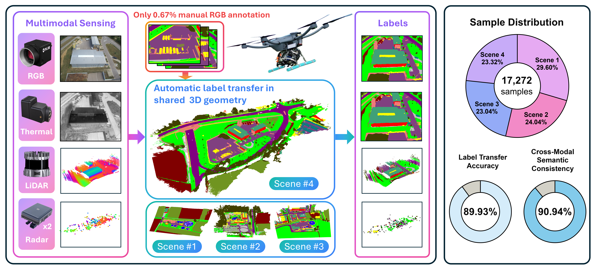

# MultiFly: A Real-World Multimodal Aerial Dataset with Annotation-Efficient Label Transfer and Cross-Modal Semantic Consistency

[Markus Gross](https://markus-42.github.io/)1,2,3,4,\*,&nbsp;
[Andreas Greiner](https://www.linkedin.com/in/andreas--greiner/)1,5,\*,&nbsp;
[Taehyoung Kim](https://www.linkedin.com/in/taehyoung-kim-935949140)1,\*,&nbsp;
[Sivasubiramaniam Subbiah](https://www.linkedin.com/in/sivasubiramaniam-subbiah-61a997217/)1,&nbsp;
[Tomaž Cotič](https://www.linkedin.com/in/toma%C5%BE-coti%C4%8D-080663333/)1,&nbsp;
[Conrad Christoph](https://www.linkedin.com/in/conrad-christoph-216255341/)1,&nbsp;
[Oussema Dhaouadi](https://ussaema.github.io/)2,3,4,&nbsp;
[Simon Zieher](https://www.linkedin.com/in/simon-zieher-86b314222/)1,&nbsp;
[Surya Kumar](https://www.linkedin.com/in/surya-kiran-v/)1,&nbsp;
[Gordon Elger](https://scholar.google.com/citations?user=klF8NzoAAAAJ&hl=en)5,&nbsp;
[Henri Meeß](https://www.linkedin.com/in/henri-meess/)1,&nbsp;
[Olaf Wysocki](https://scholar.google.com/citations?user=9xQhtFcAAAAJ&hl=en)4,&nbsp;
[Paul Spannaus](https://www.linkedin.com/in/paulspannaus/)1,&nbsp;
[Daniel Cremers](https://scholar.google.com/citations?user=cXQciMEAAAAJ&hl=en)2,3

1 [Fraunhofer IVI](https://www.ivi.fraunhofer.de/en/research-fields/advanced-air-mobility/autonomous-flying.html)&nbsp;&nbsp;&nbsp;&nbsp;
2
[TU Munich](https://cvg.cit.tum.de/)&nbsp;&nbsp;&nbsp;&nbsp;
3
[MCML](https://mcml.ai/research/groups/cremers/)&nbsp;&nbsp;&nbsp;&nbsp;
4
[Uni Cambridge](https://cv4dt.github.io/)&nbsp;&nbsp;&nbsp;&nbsp;
5
[TH Ingolstadt](https://www.thi.de/en/research/institute-of-innovative-mobility-iimo/)&nbsp;&nbsp;&nbsp;&nbsp;

⏳ **Data and Code coming soon.**

⭐ If you want receive the latest updates, consider giving this repo a star.

## 🚀 News
- **[2026/10]:** [Preprint](https://arxiv.org/abs/2610.10359) available on arXiv
